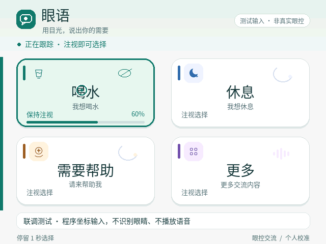
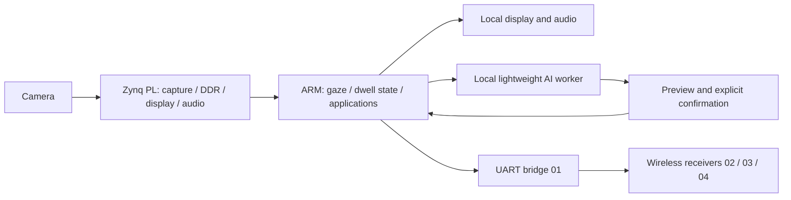

# 眼语星联——智能眼控关护系统

**EyeStarlink — Gaze Communication and Wireless Care**  
广西大学 · MZ · AMD Zynq / PYNQ

眼语星联将眼控交流、多媒体休闲和无线照护通知整合在独立嵌入式设备上。
本队伍围绕“注视选择—本地反馈—照护端显示”设计软硬件协同系统：
PL 负责相机、显示、音频与接口数据通路，ARM 负责个性化识别、交互状态机和应用调度。
无线接收端包括串口屏和两块墨水屏，帮助需求优先于普通分享。



## 功能与技术组成

- **眼控与交流**：停留选择、失效拒绝、中央参考采集、BTN2 重新定位、快捷照护表达。
- **文字与表达**：中文全拼/简拼、词句候选、续写、撤销、收藏、大字展示与心意表情。
- **自主休闲**：音乐曲名/进度/独立音量，本地视频、相册、图形配对、轻松问答、有声书续听。
- **无线关护**：喝水/休息/帮助通知、文字与表情分享、活动摘要、帮助优先、本屏确认/清除。
- **边缘 AI**：INT8 轻量 MLP、ARM NEON 内核、32 路乘加 RTL，以及 PYNQ 本机运行的 MiniMind2-Small Q8 短句生成。
- **通用开发资产**：[PYNQ portable verification Skill](skill/README.md)，可脱离眼控项目复用。



## 快速开始：无需板卡的公开回归

Python 3.10+，建议独立虚拟环境；从仓库根目录执行。

```bash
python -m pip install -r requirements-dev.txt
python tools/prepare_test_assets.py
python tools/build_ui_assets.py
python tools/verify_software.py
python -m unittest discover -s skill/pynq-portable-verification/tests -v
python tools/verify_sharing_chain.py
```

最后一项需要 GCC 在 PATH 中，也可设置 `CC`。Windows PowerShell 可用
`$env:CC='你的 gcc.exe 完整路径'`。公开测试音频是**合成测试音**，不是中文照护语音；
运行真实应用前应按 [复现说明](docs/reproduce.md) 生成/导入正式语音并校验清单。

个人眼部照片、校准模板、收藏书签、账户信息和完整私有测试日志不公开。
其中 3 项依赖个人配置或完整可选 AI 运行包的测试在公开副本中显式跳过；
其余测试仍使用原有状态机与模拟硬件检查，不以测试夹具代替真人验收。

## 工程目录及赛事提交对应关系

| 指南推荐项 | 本仓库位置 | 内容 |
|---|---|---|
| `src/` | `src/`、`native/`、`fpga/rtl/`、`comm/` | PS Python、C/NEON、RTL、四节点通信应用源码 |
| `sim/` | `tests/`、`fpga/sim/`、`comm/receiver_upgrade/tests/` | 软件回归、RTL testbench、接收端 C 假 HAL |
| `build/` | `fpga/scripts/`、`tools/rebuild.py`、`build/` | 重建脚本、现有 bit/HWH、实现报告 |
| `board/` | `board/`、`config/`、`deploy/` | 接线、硬件契约、启动服务示例 |
| `data/` | `assets/`、`skill/.../examples/` | 公开素材、字典、Q8 模型、独立测试样例 |
| `skill/` | [skill/README.md](skill/README.md) | 适用范围、用法、失败条件、经验来源与验证 |
| `report/` | [report/validation.md](report/validation.md)、[report/design.md](report/design.md) | 指标、证据层次、架构和协同开发总结 |

文件采用英文名称；保留工具要求的 `README.md`、`SKILL.md`、`LICENSE`、
`CMakeLists.txt` 和 `Kconfig` 约定名称。目录保持源码依赖关系，根目录给出完整映射。
对应指南 3.3.3.3 的开源要求、3.3.5.2 的 Skill 交付和 3.3.5.4 的命名/组织要求。

## 复现与运行

- [构建、依赖、个人校准和部署步骤](docs/reproduce.md)
- [第三方组件及素材许可](third_party_notices.md)
- [测量和验证范围](report/validation.md)
- [通用 Skill 的经验来源](skill/pynq-portable-verification/references/provenance.md)

成熟应用链路与 AI 研究模块采用显式功能开关，默认不启用无线 LIVE 或 AI 代写。
轻量神经网络的 FPGA 候选已经实现布局布线；NEON 和极小语言模型有独立板端 CPU 结果。
AI 正文/朗读/分享的新集成有离线回归，尚不能视作该集成的完整真人交互验收。
本仓库公开版重新生成了 OFL 字体资源，其回归结果与此前实机版本分别记录。

## License

本队伍原创代码与通用 Skill 使用 [MIT](LICENSE)。第三方库、模型、字体和媒体
保留各自许可证；AMD、PYNQ、HiSilicon 等名称不表示官方认证或背书。
欢迎通过 GitHub Issues 提交可复现的问题和改进建议。
